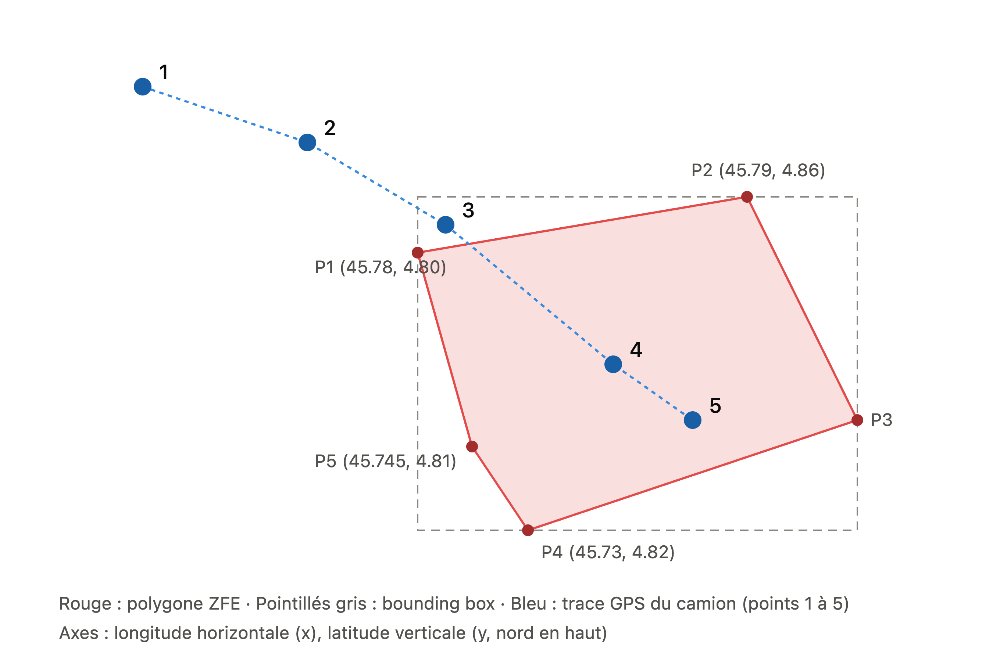

# POC Edge computing

POC pour la tablette durcie **Zebra ET40** embarquée dans les camions.
Le script fonctionne **entièrement hors ligne** et traite deux missions :

| Module               | Mission                                                                | Algorithme                             |
| -------------------- | ---------------------------------------------------------------------- | -------------------------------------- |
| **ZFE** (Geo)        | Détecter l'entrée d'un camion dans la Zone à Faibles Émissions de Lyon | Bounding Box + Ray Casting             |
| **Safety** (Physics) | Détecter les freinages violents (boîte noire assurance)                | Seuil sur l'accélération longitudinale |

## Prérequis

- [Node.js](https://nodejs.org/fr/download) **≥ 22.18** (exécute TypeScript nativement, sans build)
- [pnpm](https://pnpm.io/fr/installation) (ou npm)

## Installation

```bash
git clone https://github.com/legassy/POC
cd POC
pnpm install
```

## Lancement

```bash
pnpm start
pnpm dev  # Pour le developpement avec auto refresh (nodemon)
```

## Tests

```bash
pnpm test          # tests unitaires (node:test)
pnpm typecheck     # vérification des types
```

## Structure du projet

```
src/
├── index.ts              # point d'entrée
├── data/                 # données d'entrée (mock)
├── engines/
│   └── zfe/              # module 1 : détection ZFE
├── types/                # types partagés
└── utils/                # lecture de fichiers
```

## Module 1 — ZFE

Aperçu du polygone et du trajet GPS :



Convention : **lon = x, lat = y**.

<!-- TODO : bounding box, ray casting, polygone fermé, cas du point sur un bord, résultats vs `expected` -->

## Module 2 — Safety
